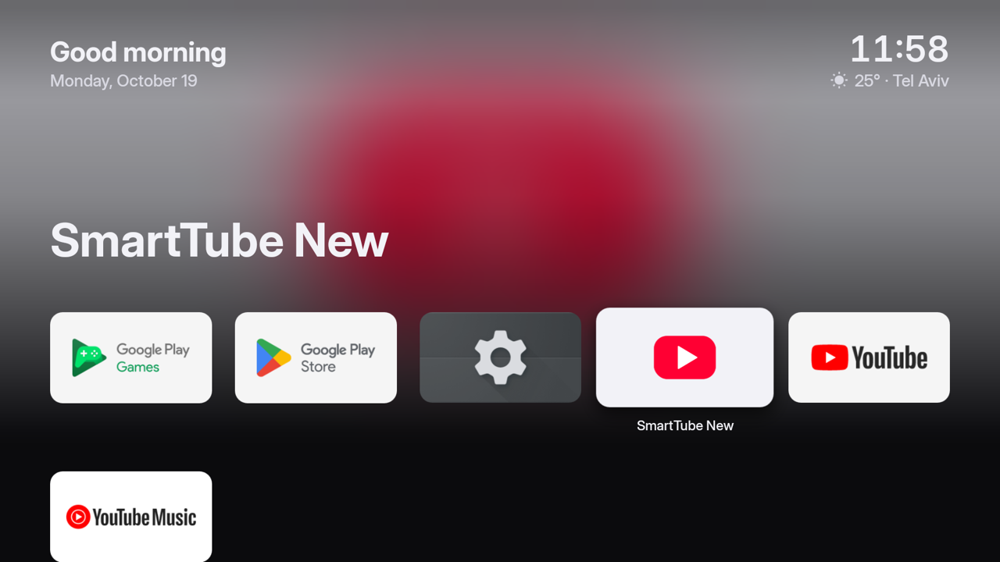
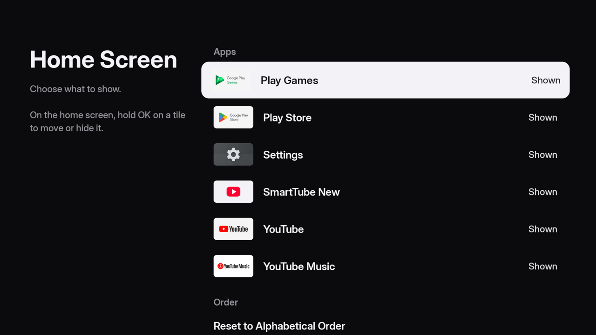

<div align="center">

# TV Launcher

**An Apple TV–style home screen for Android TV and Google TV**

Native Kotlin + Jetpack Compose. Smooth even on low-end TVs.

[](https://github.com/margantcovka/androidtv-launcher/releases/latest)




</div>

## About

A port of [webos-launcher](https://github.com/HarshInvader/webos-launcher), a tvOS-style
launcher for LG webOS TVs, to Android TV. The idea and design come from there; the code is
new. It is a native app rather than a web page, with no WebView.

It was built for a budget TV (4× Cortex-A55, Mali-470 GPU, 1.3 GB RAM) and runs at about
60 fps on it.

## Features

- **Apple TV–style top shelf**: a blurred backdrop of the focused app and its large title,
  with a greeting, the date and a clock above it.
- **Weather under the clock**: current temperature and city. The city is detected by IP or
  picked by name in settings. Celsius by default, Fahrenheit in settings, or turn it off.
- **tvOS-style grid**: wide rounded tiles, five per row. The focused tile grows, casts a
  shadow and catches a light sweep.
- **Three sections:**
  - **Apps**: all TV apps with their own banners. For apps without a banner, the icon is
    drawn over colors sampled from its edges.
  - **Sources**: live TV and HDMI/AV inputs, one click to switch.
  - **More**: home screen settings, system settings, the stock launcher.
- **Tile menu** (hold OK): move, hide from the home screen, app info.
- **Home screen settings**: show or hide any tile, weather on/off, city and units, reset to
  alphabetical order.
- Back and Home return to the top of the screen.
- **English and Russian**: the interface follows the TV's system language.
- Inter Display font, the closest open alternative to SF Pro.

<div align="center">

</div>

## Install

Requires **Android TV / Google TV 8.0 or newer**.

### Option 1: Downloader (no computer)

1. Install **Downloader** (by AFTVnews) from Google Play.
2. Allow it to install apps: *Settings → Apps → Special app access → Install unknown apps →
   Downloader*.
3. Enter this URL in Downloader:
   ```
   https://github.com/margantcovka/androidtv-launcher/releases/latest/download/tv-launcher.apk
   ```
4. Install. The app shows up as **Launcher**.

### Option 2: ADB from a computer

Enable developer options on the TV (*Settings → About*, press *Build* 7 times), then turn on
**network debugging** in *Developer options*. Download
[`tv-launcher.apk`](https://github.com/margantcovka/androidtv-launcher/releases/latest) and run:

```sh
adb connect <TV IP>:5555
adb install tv-launcher.apk
adb shell cmd package compile -m speed -f io.github.margantcovka.tvlauncher
```

The last command is optional, but on weak TVs it makes animations noticeably smoother
because the app is compiled ahead of time instead of by the JIT while animating.

## Make it the home screen

On most TVs the stock Google launcher takes priority on the **Home** button, so picking a
default launcher has no effect. A one-time ADB fix:

```sh
adb shell pm disable-user --user 0 com.google.android.tvlauncher
adb shell cmd package set-home-activity io.github.margantcovka.tvlauncher/.MainActivity
```

On **Google TV** the stock launcher is `com.google.android.apps.tv.launcherx`; use that in
the first command.

**To undo:**

```sh
adb shell pm enable com.google.android.tvlauncher
```

Without a computer: open the **More → Stock Home Screen** tile. It opens the stock
launcher's page in Settings, which has an *Enable* button.

> [!NOTE]
> Disabling the system launcher is a standard Android feature: nothing is removed, and one
> command brings it back. Still, you do this at your own risk.

## Privacy

The launcher only goes online for the weather. Unless you pick a city yourself, your
approximate location comes from your IP address via [ipapi.co](https://ipapi.co) (or
[ipwho.is](https://ipwho.is) as a fallback) and is cached for a day. IP location is often your
provider's city, so you can pick yours in *More → Home Screen → City*. The forecast comes from
[Open-Meteo](https://open-meteo.com), or [MET Norway](https://api.met.no) if Open-Meteo is
down; city search uses the Open-Meteo geocoder. No accounts, no analytics. Turn the weather
off and nothing is sent.

## Build from source

Requires JDK 21 and the Android SDK (set `sdk.dir` in `local.properties`).

```sh
./gradlew assembleRelease   # app/build/outputs/apk/release/app-release.apk
```

`tools/install.sh` builds the release APK, installs it on the TV, compiles it ahead of time
and launches it: `SERIAL=<IP>:5555 tools/install.sh`.

<details>
<summary><b>How it stays smooth on a weak TV</b></summary>


Measured with `tools/bench.py`: late frames went from ~99% to ~3%.

- Rounded tiles and shadows are pre-rendered bitmaps, so the GPU never clips shapes or
  computes shadows.
- The full-screen backdrop is a single opaque 64×36 image blended on the CPU. No live blur,
  and the window background is off.
- Animations are read in the draw phase and never trigger recomposition.
- Ahead-of-time compilation (`cmd package compile -m speed`); otherwise the JIT eats ~30%
  of the CPU during animations.

`tools/cadence.sh` reports the panel's real refresh rate. `tools/bench.py --dbg N` turns
off parts of the drawing (bits in `Debug.kt`) to measure what each one costs.
</details>

<details>
<summary><b>Code layout</b></summary>

```
app/src/main/java/io/github/margantcovka/tvlauncher/
  MainActivity.kt              screens (home / settings), reload on onResume, Home button
  data/LauncherRepository.kt   all tiles: apps + sources + More
  data/AppSource.kt            TV apps, banners and icons (cached by lastUpdateTime)
  data/InputSource.kt          live TV and HDMI/AV inputs
  data/SymbolTiles.kt          icon-and-label tiles (inputs, More)
  data/LauncherPrefs.kt        tile order and hidden tiles (SharedPreferences)
  data/Weather.kt              location by IP or chosen city, Open-Meteo / MET Norway, cache
  data/Launcher.kt             what a tile does on OK
  data/Images.kt               rounded tiles, shadows, blurred top shelf backdrop
  ui/HomeScreen.kt             top shelf + grid by section, tile menu, reordering
  ui/Tile.kt                   tile: scale, shadow, light sweep, label
  ui/TileMenu.kt, FocusRow.kt  hold-OK menu, tvOS-style rows
  ui/SettingsScreen.kt         home screen settings
  ui/CityScreen.kt             city search for the weather
  ui/ShelfRenderer.kt          CPU blending of the top shelf backdrop
  ui/Tokens.kt                 colors, sizes, timings
```
</details>

## See also

[**SmartTube New**](https://github.com/margantcovka/SmartTube-New): a SmartTube fork with a
UI in the style of this launcher.

## Credits and license

- Design and idea: [HarshInvader/webos-launcher](https://github.com/HarshInvader/webos-launcher) (MIT).
- [Inter](https://rsms.me/inter/) font (SIL OFL 1.1, see `licenses/Inter-OFL.txt`), Material Icons (Apache 2.0).

Released under the [MIT](LICENSE) license.
